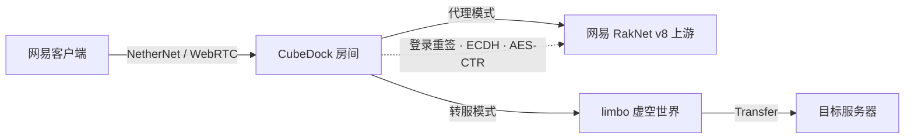

# CubeDock 方块码头

<p align="center">
  <a href="https://github.com/emuyx/CubeDock/releases/latest"></a>
  <a href="https://github.com/emuyx/CubeDock/actions/workflows/release.yml"></a>
  
  
  <a href="https://emuyx.github.io/CubeDock/"></a>
</p>

> 网易「本地联机」房间 → 原生支持网易 RakNet v8 的 Bedrock 服务器。<br>
> 独立实现：不翻译游戏协议，只做登录链重签、Bedrock 加密握手、limbo/Transfer 和资源包处理。

[项目主页](https://emuyx.github.io/CubeDock/) · [真实界面演示](https://emuyx.github.io/CubeDock/demo.html) · [下载](https://github.com/emuyx/CubeDock/releases/latest) · [FAQ](#faq) · [Issues](https://github.com/emuyx/CubeDock/issues)

## 一眼看懂

| 项目 | 内容 |
| --- | --- |
| 连接模式 | 代理模式（推荐）/ 转服模式（先进中转房间） |
| 兼容性 | 网易互通版 3.10；服务器需原生支持网易 RakNet v8 |
| 上游要求 | 代理和转服都要求服务器原生支持网易 RakNet v8；转服还需要客户端能直连该服务器 |
| 平台 | Windows / Linux / macOS |
| 控制台 | React + MUI，默认 `http://127.0.0.1:18321/` |

## 架构



## 模式怎么选

| 你的场景 | 推荐 |
| --- | --- |
| 上游原生支持网易 RakNet v8，长期稳定中继 | **代理模式** |
| 不想额外运行 limbo，希望部署更简单 | **代理模式** |
| 希望目标服务器看到玩家真实 IP / 延迟 | **转服模式** |
| 想先进入 limbo 大厅或表单，再跳到目标 | **转服模式** |
| 目标有未加密静态资源包，需要提前预加载 | **转服模式** |
| 目标资源包加密或动态生成 | **代理模式**（当前转服不支持） |

## 能力

| 能力 | 说明 |
| --- | --- |
| 互通版直登 | 邮箱密码走 a50 / x19 / uni_sauth，无需抓包 |
| 加密中继 | P-384 单段链重签、ECDH / AES-CTR、游戏包直通 |
| limbo 转服 | 虚空世界、SimpleForm、关闭重开、`Transfer.ReloadWorld=false` |
| 资源包 | 强制 SendPacks、Stack fallback、拉取、本地跳过、去重 |
| Web 控制台 | 账号/房间、连接方式、实时控制台、诊断、设置、FAQ、玩家管理（代理模式）、深浅色主题 |
| 多房间 | 多账号、不设固定上限，一账号一房间；代理模式下支持 `list` / `kick` |

## 下载与安装

从 [Releases](https://github.com/emuyx/CubeDock/releases/latest) 下载对应系统的压缩包，解压后运行：

- **Windows**：双击 `CubeDock.exe`。
- **Linux / macOS**：在终端运行解压出的程序，必要时先 `chmod +x`。

首次启动会在终端显示控制台地址并自动打开浏览器；首次进入时请先创建管理员账号和密码，再按页面上的设置向导完成服务器、账号和预检。

> **上游要求**：无论代理还是转服，服务器都必须原生支持网易 RakNet v8；标准 BDS 不能直接使用。
> 转服模式的目标由客户端直连，但仍需客户端可访问目标、资源包与 limbo 预加载的一致。

### 使用步骤

1. **启动并登录控制台**
   运行 `CubeDock.exe`（或 `build/bin/CubeDockMain`），打开终端显示的地址，默认
   `http://127.0.0.1:18321/`。首次打开控制台时会要求你创建管理员账号和密码。无头环境可用
   `CUBEDOCK_ADMIN_USERNAME` / `CUBEDOCK_ADMIN_PASSWORD` 仅做首次初始化。

2. **配置服务器**
   进入「设置」填写服务器地址（例如 `127.0.0.1:19132`）、房间名和人数，
   然后保存。无论代理还是转服，服务器都必须原生支持网易 RakNet v8。

3. **添加网易账号**
   进入「账号与房间」→「添加网易账号」，使用互通版邮箱直登，或导入已有的 `sauth`。
   每个账号对应一个房间；同一账号不能重复添加。

4. **启动房间**
   回到「主页」点击「启动房间」。房间进入 online 后，房间号会显示在「本地联机房间」
   卡片中；服务器地址和连接状态也会同步更新。

5. **手机加入**
   在网易版 Minecraft 客户端打开「本地联机」，刷新后加入刚创建的房间。玩家流量会经
   CubeDock 转发到上游；在上游看到的身份和连接由代理配置决定。

6. **转服模式（可选）**
   在「连接与资源包」把连接方式改为「转服模式」，配置中转房间和资源包，
   保存后重新启动房间。玩家会先进入本地中转房间，看到提示页面后再进入你的服务器。

7. **管理玩家**
   代理模式下可在「控制台」使用 `list` 查看玩家、`kick <ID|名称>` 断开玩家；`transfer`
   可向指定玩家注入 Transfer（POC）。转服模式的玩家已交给中转房间/目标服务器，
   CubeDock 不再提供玩家管理。停止房间会结束房主机器人和 limbo。

## 常用操作

| 命令 | 说明 |
| --- | --- |
| `help` | 显示帮助 |
| `list` | 玩家 ID、名称、房间、状态、在线时长、上下行包数 |
| `kick <ID\|名称>` | 断开指定玩家；名称含空格时加引号 |
| `transfer <ID\|名称> <host:port>` | 代理模式下注入 Transfer（POC） |

配置字段见 [`config.example.json`](config.example.json)。数据文件：`config.json`、
`room-tokens.dat`、`accounts.json`、`interop-device.dat`、`admin.json`、`logs/`。
Windows 使用 DPAPI，其他平台使用 `0600` 权限。

<details>
<summary><strong>HTTP API</strong> · 需要管理员会话</summary>

| 方法 | 路径 | 说明 |
| --- | --- | --- |
| GET | `/api/status` | 状态、账号、房间、事件 |
| POST | `/api/start` / `/api/stop` | 启动/停止全部房间 |
| POST | `/api/config` | 保存配置 |
| GET | `/api/packs` | 扫描资源包目录 |
| POST | `/api/packs/refresh` | 机器人拉取并去重 |
| POST | `/api/console` | 执行控制台命令 |
| GET | `/api/players` | 在线玩家列表（仅代理模式有实际数据） |
| POST | `/api/player/kick` | 断开玩家 |
| POST | `/api/player/transfer` | 请求玩家转服（实验） |
| GET | `/api/diagnostics` | 只读运行诊断 |
| GET | `/api/backup` | 导出配置备份（不含登录凭证） |
| POST | `/api/restore` | 恢复配置 |

`/api/session/*` 只允许本机访问；控制台只允许白名单 Host/Origin。
</details>

## FAQ

<details>
<summary><strong>代理模式和转服模式有什么区别？</strong></summary>

**代理模式**：玩家经 CubeDock 中继到上游，登录链重签、游戏包直通。适合上游原生支持
网易 RakNet v8、长期稳定中继、需要上游看到网易身份、不想运行 limbo 的场景。

**转服模式**：玩家先进入 limbo 预加载资源包并显示表单，点击后直连目标服务器。适合
客户端能直连目标、资源包未加密且静态、希望目标看到真实 IP/延迟、需要 limbo 大厅的
场景。目标有资源包时必须与 limbo 预加载的一致；加密/动态包不适合。
</details>

<details>
<summary><strong>标准 BDS 能直接作为上游吗？</strong></summary>

两种模式都不能直接使用标准 BDS：服务器必须原生支持网易 RakNet v8。转服模式只是让客户端
直连目标，同样不会把网易协议翻译成标准 Bedrock；此外还要求客户端能访问目标、资源包与
limbo 预加载的一致。
</details>

<details>
<summary><strong>进服/资源包/控制台常见问题</strong></summary>

- 玩家刚进房就断开：先检查服务器是否支持网易协议、版本是否接近，以及资源包是否一致。
- 登录时提示需要安全验证（1351）：点击页面上的「打开网易验证页面」完成验证，再回到 CubeDock 点一次「登录并添加」。CubeDock 不会自动重试。
- 登录凭据过期：刷新不会续期；在账号页点「更新登录」，用邮箱密码或新的 sauth 重新登录。
- 资源包不下载：网易会忽略 `ResourcePacksInfo`，limbo 默认强制 SendPacks；加密/动态包不支持。
- 控制台打不开：默认 `http://127.0.0.1:18321/`；忘记密码需停止程序、备份并删除数据目录中的 `admin.json`，重启后在本机控制台重新创建管理员账户。
- 同一网易账号不能同时开两个房间；账号数量不设固定上限，实际受机器资源与网易限制。
</details>

更多 FAQ 见 [项目主页](https://emuyx.github.io/CubeDock/#faq) 和 WebUI 的「常见问题」页面。

## 开发

<details>
<summary><strong>从源码构建</strong></summary>

Windows：

```powershell
git clone https://github.com/emuyx/CubeDock.git
cd CubeDock
.\scripts\build.ps1
.\build\CubeDock.exe
```

Linux / macOS：

```bash
git clone https://github.com/emuyx/CubeDock.git
cd CubeDock
go build -trimpath -o build/bin/CubeDockMain ./cmd/cubedock
(cd limbo && go build -trimpath -o ../build/bin/limbo .)
./build/bin/CubeDockMain
```

需要 Go 1.26+（会自动使用 `go.mod` 指定的 1.27.3 工具链）与 Node.js 24。
</details>

```bash
go test ./...
go vet ./...
go -C limbo test ./...
npm --prefix webui-src ci
npm --prefix webui-src run build
```

Windows 一键构建：`.\scripts\build.ps1`。前端缺少依赖时会自动 `npm ci`。

## 当前状态

| 能力 | 状态 |
| --- | --- |
| 代理模式真实进服 | ✅ 实机验证 |
| 转服 / limbo / 资源包 | ✅ 实机验证 |
| 资源包拉取、跳过、去重 | ✅ 实机验证 |
| 真实 1351 / 多账号 / 多房间 | ✅ 实机验证 |
| 真实玩家 `list` / `kick`（代理模式） | ✅ 实机验证 |
| 加密 / 动态资源包 | 🚧 未支持 |

## 许可

| 组件 | 许可 |
| --- | --- |
| CubeDock 原创代码（含认证链 `internal/netease`） | MIT，`Copyright (c) 2026 emuyx` |
| `vendor-src/nemc-tan-lobby-solver` | MIT 子目录各自保留 LICENSE |
| `limbo/third_party/gophertunnel` | MIT |

完整归属见 [NOTICE](NOTICE)、[THIRD_PARTY_NOTICES.md](THIRD_PARTY_NOTICES.md) 和
[LICENSE](LICENSE)。发布包中的 `licenses/` 提供 MIT/BSD/Apache 许可文本与
vendored 组件的 LICENSE 副本，不再包含 AGPL 源码包。

> CubeDock 是独立项目，与 Mojang、Microsoft、网易无隶属关系；不附带游戏客户端或
> 官方资源。使用网易账号与本地联机功能可能受网易服务条款约束，风险由使用者承担。
