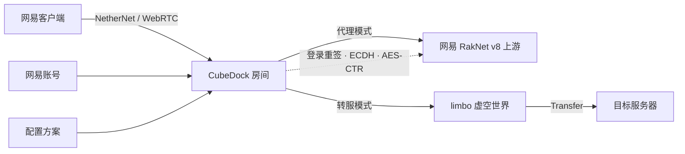

# CubeDock 方块码头

<p align="center">
  <a href="https://github.com/emuyx/CubeDock/releases/latest"></a>
  <a href="https://github.com/emuyx/CubeDock/actions/workflows/release.yml?query=branch%3Amain"></a>
  
  
  <a href="https://emuyx.github.io/CubeDock/"></a>
</p>

> 网易「本地联机」房间 → 原生支持网易 RakNet v8 的 Bedrock 服务器。<br>
> 独立实现：不翻译游戏协议，只做登录链重签、Bedrock 加密握手、limbo/Transfer 和资源包处理。

[项目主页](https://emuyx.github.io/CubeDock/) · [使用文档](https://emuyx.github.io/CubeDock/docs.html) · [真实界面演示](https://emuyx.github.io/CubeDock/demo.html) · [下载](https://github.com/emuyx/CubeDock/releases/latest) · [测试版构建](https://github.com/emuyx/CubeDock/actions/workflows/release.yml?query=branch%3Amain) · [FAQ](#faq) · [Issues](https://github.com/emuyx/CubeDock/issues)

## 一眼看懂

| 项目 | 内容 |
| --- | --- |
| 连接模式 | 代理模式（推荐）/ 转服模式（先进中转房间） |
| 兼容性 | 网易互通版 3.10；服务器需原生支持网易 RakNet v8 |
| 上游要求 | 代理和转服都要求服务器原生支持网易 RakNet v8；转服还需要客户端能直连该服务器 |
| 配置方案 | 多套服务器/房间/资源包设置；每个账号选择一套方案 |
| 认证 | 第一方 `internal/netease`：PE 认证、用户资料、transfer 节点、房主凭据 |
| 平台 | Windows / Linux / macOS |
| 控制台 | React + MUI；配置方案页 + 每账号仪表盘，默认 `http://127.0.0.1:18321/` |

> 当前开发版本 **v0.4.0-dev**；最新正式发布仍为 **v0.3.2**，可从
> [Releases](https://github.com/emuyx/CubeDock/releases/latest) 下载对应系统的发布包。
> `main` 分支包含多登录方式和网易手游邮箱/密码直登改动，尚未正式发布。

## 架构



每个账号拥有独立 runtime、独立启停和独立房间；账号使用的服务器、房间与资源包设置来自
它选择的配置方案。切换方案需要先停止全部房间，下次启动该账号时生效。

## 模式怎么选

| 你的场景 | 推荐 |
| --- | --- |
| 上游原生支持网易 RakNet v8，长期稳定中继 | **代理模式** |
| 不想额外运行 limbo，希望部署更简单 | **代理模式** |
| 希望目标服务器看到玩家真实 IP / 延迟 | **转服模式** |
| 想先进入 limbo 大厅或表单，再跳到目标 | **转服模式** |
| 目标有未加密静态资源包，需要提前预加载 | **转服模式** |
| 目标资源包加密或动态生成 | **代理模式**（当前转服不支持） |

## 能力

| 能力 | 说明 |
| --- | --- |
| 多登录方式 | 基岩互通版邮箱/sauth；网易手游会话导入 + 邮箱/密码直登（真机验证：登录/开房/进服）；4399/PC 后续 |
| 互通版直登 | 邮箱密码走 a50 / x19 / uni_sauth，无需抓包 |
| 第一方认证链 | `internal/netease` 实现 PE 认证、资料、transfer 节点和开房凭据；不再依赖 AGPL 组件 |
| 加密中继 | P-384 单段链重签、ECDH / AES-CTR、游戏包直通 |
| limbo 转服 | 虚空世界、SimpleForm、关闭重开、`Transfer.ReloadWorld=false` |
| 资源包 | 强制 SendPacks、Stack fallback、拉取、本地跳过、去重 |
| 配置方案 | 多套连接/房间/资源包/表单设置；支持复制方案、按方案查看资源包 |
| 账号仪表盘 | 每账号独立启动/停止/重连、房间状态、玩家、好友申请、资源包、诊断、日志 |
| 房间管理 | 房间侧踢人、房间标签（最多 3 个）、准入等级、网易房间成员列表 |
| 好友申请 | 运行中房间读取待处理申请，可自动或手动同意 |
| Web 控制台 | 账号/房间、配置方案、实时控制台、诊断、设置、FAQ、深浅色主题；移动端使用卡片布局和全屏操作面板 |
| 多房间 | 多账号、不设固定上限，一账号一房间；代理模式下支持 `list` / `kick` |

## 下载与安装

从 [Releases](https://github.com/emuyx/CubeDock/releases/latest) 下载对应系统的压缩包，解压后运行：

- **Windows**：双击 `CubeDock.exe`。
- **Linux / macOS**：在终端运行解压出的程序，必要时先 `chmod +x`。

> **测试版构建**：想提前试用 `main` 的最新代码，可以在
> [Build and Release](https://github.com/emuyx/CubeDock/actions/workflows/release.yml?query=branch%3Amain)
> 的最近一次运行中下载 artifacts。测试版未经完整实机验收，不建议直接用于长期生产。

首次启动会在终端显示控制台地址并自动打开浏览器；首次进入时请先创建管理员账号和密码，再按页面上的设置向导完成服务器、账号和预检。

> **上游要求**：无论代理还是转服，服务器都必须原生支持网易 RakNet v8；标准 BDS 不能直接使用。
> 转服模式的目标由客户端直连，但仍需客户端可访问目标、资源包与 limbo 预加载的一致。

### 使用步骤

1. **启动并登录控制台**
   运行 `CubeDock.exe`（或 `build/bin/CubeDockMain`），打开终端显示的地址，默认
   `http://127.0.0.1:18321/`。首次打开控制台时会要求你创建管理员账号和密码；初始化只允许本机。
   无头环境可用 `CUBEDOCK_ADMIN_USERNAME` / `CUBEDOCK_ADMIN_PASSWORD` 仅做首次初始化。

2. **完成全局设置**
   在「设置」中确认控制台端口、limbo 程序路径和是否自动启动全部房间。服务器、房间、
   资源包和提示页面属于配置方案，不在「设置」页修改。

3. **创建配置方案**
   进入「配置方案」新建或复制方案，按需要填写：
   - 「连接」：连接方式（代理/转服）、服务器地址、房间协议版本；
   - 「房间」：房间名、密码、人数、准入等级、房间标签、仅好友可见、自动同意好友、PvP；
   - 「资源包」：资源包目录与是否开房时自动拉取；
   - 「提示页面」：转服模式 limbo 表单标题、内容和按钮文字。

4. **添加网易账号**
   进入「账号与房间」→「添加网易账号」，选择配置方案和登录方式：
   - 「基岩互通版邮箱/密码」：使用网易邮箱和密码直登，或导入已有的互通版 `sauth`；
   - 「网易手游邮箱/密码」：使用手游账号的邮箱和密码直登（本地实现，真实账号/开房待实测），
     也可以在「会话类型」中选择「网易手游会话」，粘贴包含 `platform=ad`、`app_channel`、
     `sessionid`、`access_token` 的手游 `sauth_json`。
   每个账号对应一个房间；同一账号不能重复添加。两种登录方式可以同时存在。

5. **启动房间**
   在「账号与房间」或侧边栏账号入口打开该账号的仪表盘，单独「启动 / 停止 / 重连」。
   房间进入 online 后，房间号会显示在「本地联机房间」卡片中；主页的全局启动/停止会作用于全部账号。

6. **手机加入**
   在网易版 Minecraft 客户端打开「本地联机」，刷新后加入刚创建的房间。玩家流量会经
   CubeDock 转发到上游；在上游看到的身份和连接由配置方案决定。

7. **转服模式（可选）**
   在「配置方案」把连接方式改为「转服模式」，配置中转房间地址/端口、limbo 提示页面和资源包，
   保存后重新启动该账号的房间。玩家会先进入本地中转房间，看到提示页面后再进入你的服务器。

8. **管理玩家、房间成员与好友**
   代理模式下可在「控制台」使用 `list` 查看玩家、`kick <ID|名称>` 断开玩家；`transfer`
   可向指定玩家注入 Transfer（POC）。玩家弹窗还提供「已进入世界」和「网易房间成员」两个标签：
   后者包含已进房但尚未进入世界的玩家，可按房间玩家 ID 踢出。房间运行后，账号仪表盘可读取
   并手动同意好友申请。转服模式的玩家由中转房间/目标服务器承载，CubeDock 不提供世界玩家管理。
   停止房间会结束房主机器人和 limbo。

## 常用操作

| 命令 | 说明 |
| --- | --- |
| `help` | 显示帮助 |
| `list` | 玩家 ID、名称、房间、状态、在线时长、上下行包数 |
| `kick <ID\|名称>` | 断开指定玩家；名称含空格时加引号 |
| `transfer <ID\|名称> <host:port>` | 代理模式下注入 Transfer（POC） |

房间侧踢人、标签和准入等级在 Web 控制台操作：

- **世界玩家**：玩家弹窗的「已进入世界」标签，可断开本地 NetherNet 连接；
- **网易房间成员**：「网易房间成员」标签，包含等待中的玩家；房间踢出依赖 `dockerB`
  transfer 节点（SignalWebPort 8900），踢出不等于封禁，玩家仍可能重新加入；
- **标签/准入等级**：在配置方案中设置，保存后重新启动房间生效；
- **等待中的成员**：`TanNewGuestResponse` 不带游戏名，未进入世界时显示为 `房间玩家 <ID>`。

配置字段见 [`config.example.json`](config.example.json)。数据文件：`config.json`
（全局设置 + 配置方案）、`room-tokens.dat`、`accounts.json`（含 `profile_id` / `auth_method`）、
`interop-device.dat`、`mobile-device.dat`、`admin.json`、`logs/`。Windows 使用 DPAPI，
其他平台使用 `0600` 权限。

<details>
<summary><strong>HTTP API</strong> · 除登录/初始化外需要管理员会话</summary>

| 方法 | 路径 | 说明 |
| --- | --- | --- |
| GET | `/api/setup/status` | 是否仍需要初始化管理员 |
| POST | `/api/setup` | 创建首个管理员（仅本机） |
| POST | `/api/login` / `/api/logout` | 管理员登录/退出 |
| POST | `/api/admin/password` | 修改管理员密码 |
| GET | `/api/status` | 状态、账号、配置方案、房间、事件 |
| POST | `/api/start` / `/api/stop` | 启动/停止全部房间 |
| POST | `/api/room/start` / `/api/room/stop` / `/api/room/restart` | 单账号开房/停止/重连 |
| POST | `/api/config` | 保存配置方案与全局设置 |
| POST | `/api/account/assign-profile` | 为账号切换配置方案 |
| POST | `/api/account/profile` | 刷新账号资料 |
| POST | `/api/account/remove` | 移除账号 |
| GET | `/api/packs?profile_id=` | 扫描某方案的资源包目录 |
| POST | `/api/packs/refresh` | 机器人拉取并去重 |
| POST | `/api/console` | 执行控制台命令 |
| GET | `/api/players` | 已进入世界的玩家（仅代理模式有实际数据） |
| GET | `/api/room/members?index=` | 网易房间成员（含未进入世界） |
| POST | `/api/player/kick` | 断开世界玩家 |
| POST | `/api/player/room-kick` | 通过房间控制通道踢出世界玩家 |
| POST | `/api/room/kick-member` | 按房间玩家 ID 踢出（含未进世界） |
| GET | `/api/friends?index=` | 运行中房间的好友申请列表 |
| POST | `/api/friend/accept` | 手动同意好友申请 |
| POST | `/api/player/transfer` | 请求玩家转服（实验） |
| GET | `/api/diagnostics?profile_id=` | 只读运行诊断 |
| GET | `/api/backup` | 导出配置备份（不含登录凭证） |
| POST | `/api/restore` | 恢复配置 |
| POST | `/api/session/import` | 导入 sauth；请求体用 `auth_method` 选择 `interop` / `mobile_netease`（仅本机） |
| POST | `/api/session/interop-login` | 基岩互通版邮箱登录（仅本机） |
| POST | `/api/session/mobile-login` | 网易手游邮箱/密码登录（仅本机；main 分支本地实现） |

`/api/session/*` 只允许本机访问；控制台只允许白名单 Host/Origin。
</details>

## FAQ

<details>
<summary><strong>代理模式和转服模式有什么区别？</strong></summary>

**代理模式**：玩家经 CubeDock 中继到上游，登录链重签、游戏包直通。适合上游原生支持
网易 RakNet v8、长期稳定中继、需要上游看到网易身份、不想运行 limbo 的场景。

**转服模式**：玩家先进入 limbo 预加载资源包并显示表单，点击后直连目标服务器。适合
客户端能直连目标、资源包未加密且静态、希望目标看到真实 IP/延迟、需要 limbo 大厅的
场景。目标有资源包时必须与 limbo 预加载的一致；加密/动态包不适合。
</details>

<details>
<summary><strong>配置方案、账号和房间是什么关系？</strong></summary>

配置方案保存服务器、房间、资源包和提示页面设置；账号在添加时选择一套方案，并获得
独立的房间 runtime。一个账号只能有一个房间；多个账号可以共用同一方案，也可以使用不同方案。
切换账号的方案需要先停止全部房间，切换后下次启动该账号的房间时生效。
</details>

<details>
<summary><strong>标准 BDS 能直接作为上游吗？</strong></summary>

两种模式都不能直接使用标准 BDS：服务器必须原生支持网易 RakNet v8。转服模式只是让客户端
直连目标，同样不会把网易协议翻译成标准 Bedrock；此外还要求客户端能访问目标、资源包与
limbo 预加载的一致。
</details>

<details>
<summary><strong>房间踢人和世界玩家踢人有什么区别？</strong></summary>

「已进入世界」标签断开的是已经进入上游世界的玩家；「网易房间成员」标签踢出的是 TanLobby
房间成员，包含已进房但还没进入世界的玩家。房间踢出依赖 `dockerB` transfer 节点；踢出不会
封禁，玩家仍可能重新加入，除非房间设置了仅好友、密码或准入等级。
</details>

<details>
<summary><strong>支持哪些登录方式？</strong></summary>

- **基岩互通版**：邮箱密码直登，或导入互通版 `sauth`（platform=pc / app_channel=a50_sdk_cn）；
- **网易手游**：邮箱密码直登会注册新设备，使用 `/devices` 返回的 device key
  加密登录参数；已真机验证通过登录、开房、进服。也支持导入手游 `sauth_json`
  （platform=ad / app_channel=netease...），需要包含 `sessionid` 和 `access_token`；
- 两种方式可以同时存在，账号通过 `accounts.json` 的 `auth_method` 区分；
- 4399 手游、Java 经典版网易/4399 渠道仍在后续计划中。
</details>

<details>
<summary><strong>为什么认证链不再使用 AGPL 组件？</strong></summary>

当前认证链由 `internal/netease` 第一方实现，覆盖 PE 认证、用户资料、transfer 节点选择和
房主凭据派生。`vendor-src/g79client`、`internal/funauth` 已删除，发布包也不再生成
`SOURCE/`；第三方许可文本仍随包分发。协议常量仍以真实抓包和实机验证为准。
</details>

<details>
<summary><strong>进服/资源包/控制台常见问题</strong></summary>

- 玩家刚进房就断开：先检查服务器是否支持网易协议、版本是否接近，以及资源包是否一致。
- 登录时提示需要安全验证（1351）：点击页面上的「打开网易验证页面」完成验证，再回到 CubeDock 点一次「登录并添加」。CubeDock 不会自动重试。
- 登录凭据过期：刷新不会续期；在账号页点「更新登录」，用邮箱密码或新的 sauth 重新登录。
- 资源包不下载：网易会忽略 `ResourcePacksInfo`，limbo 默认强制 SendPacks；加密/动态包不支持。
- 控制台打不开：默认 `http://127.0.0.1:18321/`；忘记密码需停止程序、备份并删除数据目录中的 `admin.json`，重启后在本机控制台重新创建管理员账户。
- 房间踢出生效但玩家又回来了：踢出不封禁；可配合仅好友、密码或准入等级限制。
- 同一网易账号不能同时开两个房间；账号数量不设固定上限，实际受机器资源与网易限制。
</details>

更多 FAQ 见 [使用文档](https://emuyx.github.io/CubeDock/docs.html#troubleshooting) 和 WebUI 的「常见问题」页面。

## 开发

<details>
<summary><strong>从源码构建</strong></summary>

Windows：

```powershell
git clone https://github.com/emuyx/CubeDock.git
cd CubeDock
.\scripts\build.ps1
.\build\CubeDock.exe
```

Linux / macOS：

```bash
git clone https://github.com/emuyx/CubeDock.git
cd CubeDock
go build -trimpath -o build/bin/CubeDockMain ./cmd/cubedock
(cd limbo && go build -trimpath -o ../build/bin/limbo .)
./build/bin/CubeDockMain
```

需要 Go 1.26+（会自动使用 `go.mod` 指定的 1.27.4 工具链）与 Node.js 24。
</details>

```bash
go test ./...
go vet ./...
go -C limbo test ./...
go -C limbo vet ./...

npm --prefix webui-src ci
npm --prefix webui-src run build
```

Windows 一键构建：`.\scripts\build.ps1`。前端缺少依赖时会自动 `npm ci`。
站点文件在 `site/`，其中 `docs.html` 是使用文档，`demo.html` 是控制台演示。

## 当前状态

| 能力 | 状态 |
| --- | --- |
| 代理模式真实进服 | ✅ 实机验证 |
| 转服 / limbo / 资源包 | ✅ 实机验证 |
| 资源包拉取、跳过、去重 | ✅ 实机验证 |
| 真实 1351 / 多账号 / 多房间（实机测试到 8 个） | ✅ 实机验证 |
| 真实玩家 `list` / `kick`（代理模式） | ✅ 实机验证 |
| 多配置方案 + 每账号仪表盘 | ✅ 实机验证 |
| 第一方认证链（PE/资料/开房） | ✅ 本地测试 + 真实账号探针 + 实机 |
| 网易手游会话导入（PE/资料） | ✅ 真实抓包 + 本地端到端探针；同一 sauth 链路已真机开房/进服 |
| 网易手游邮箱/密码直登 | ✅ 真机验证：登录 / 开房 / 进服 |
| 房间侧踢人 / 标签 / 准入等级 | ✅ 实机验证（踢人依赖 dockerB） |
| 网易房间成员列表（含未进世界） | ✅ 实机验证 |
| 手动同意好友申请 | ✅ 实机验证 |
| `govulncheck`（root / limbo） | ✅ 0 个可达漏洞（Go 1.27.4） |
| `npm audit` | ✅ 0 vulnerabilities |
| 重复测试 / 跨平台构建 | ✅ 3× 全量测试 / 6 平台构建 |
| 加密 / 动态资源包 | 🚧 未支持 |
| Linux / macOS 实机 | ⏳ 部分覆盖（WSL + 交叉编译） |
| `go test -race` | ⏳ 未运行（本机无 gcc/cgo） |

> **验证范围**：真实多账号/多房间验收覆盖到 8 个账号；本地有 16 房间监督测试
> （`TestManagerSupervisesSixteenRooms`）。账号数量不设硬上限，实际可用数量受机器资源
> （内存、文件描述符、UDP 端口、limbo 进程）和网易侧限制影响；>8 的真实压力测试尚未执行，
> 这不是一个代码阈值，也没有已知的 8 账号相关缺陷。

证书与兼容性说明：基岩互通版 PE 常量仍为 `3.10.5.301486`；网易手游抓包版本为
`3.10.16.302017`（engine `3.10.5.301327`、patch `3.10.16.302017`）。默认房间版本
`1.21.130.0`、协议 `43`。客户端 manifest 更新后，必须重新抓包并验证，不能只改常量。

## 许可

| 组件 | 许可 |
| --- | --- |
| CubeDock 原创代码（含认证链 `internal/netease`） | MIT，`Copyright (c) 2026 emuyx` |
| `vendor-src/nemc-tan-lobby-solver` | MIT 子目录各自保留 LICENSE |
| `limbo/third_party/gophertunnel` | MIT |

完整归属见 [NOTICE](NOTICE)、[THIRD_PARTY_NOTICES.md](THIRD_PARTY_NOTICES.md) 和
[LICENSE](LICENSE)。发布包中的 `licenses/` 提供 MIT/BSD/Apache 许可文本与
vendored 组件的 LICENSE 副本，不再包含 AGPL 源码包。

> CubeDock 是独立项目，与 Mojang、Microsoft、网易无隶属关系；不附带游戏客户端或
> 官方资源。使用网易账号与本地联机功能可能受网易服务条款约束，风险由使用者承担。
